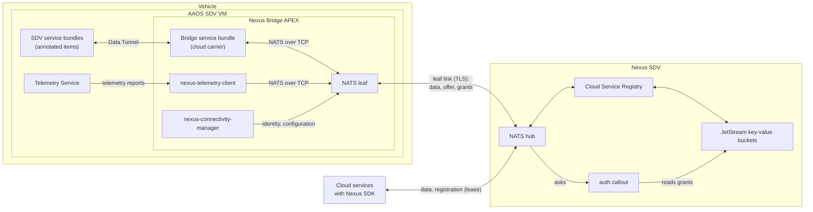
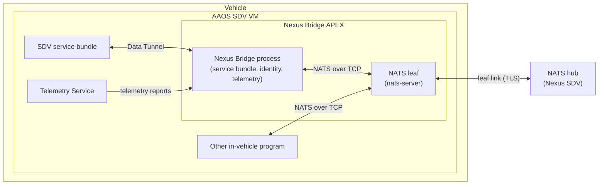
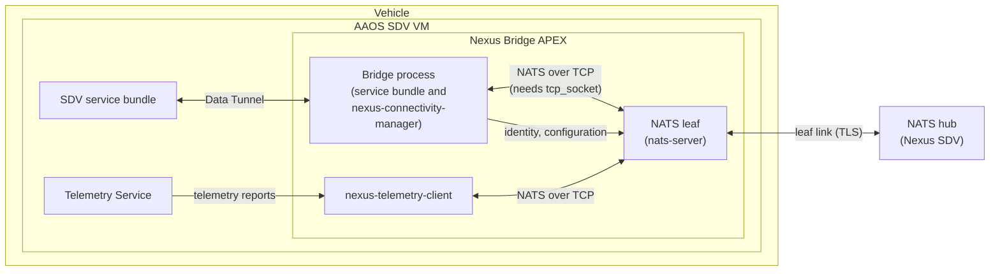
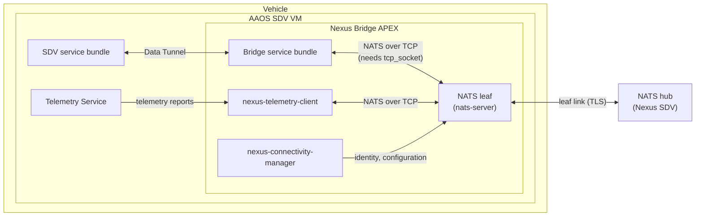
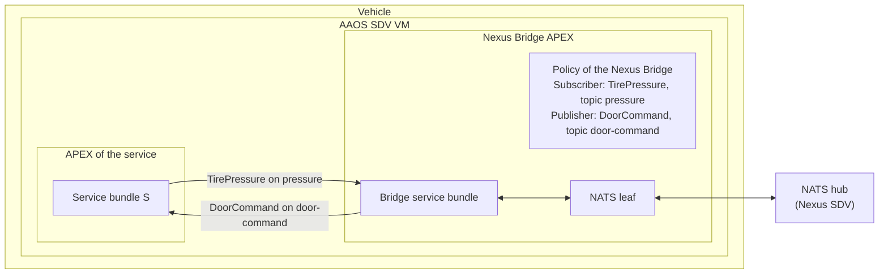
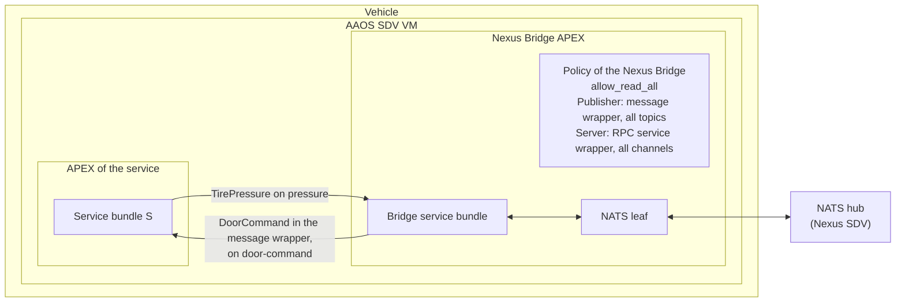
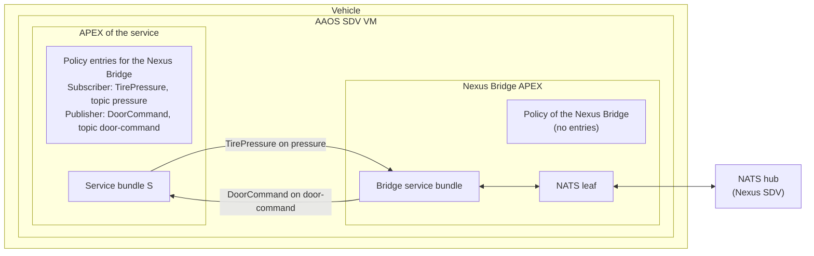
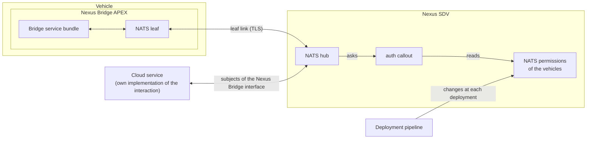
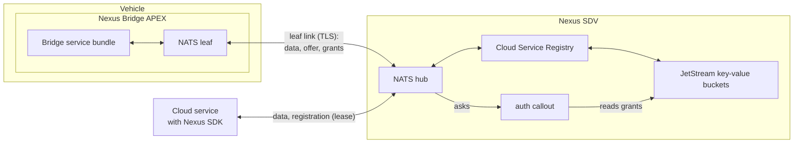

# ADR-0005: Nexus Bridge V1 — sdv/ Onboard Subsystem Architecture

| Field | Value |
| :--- | :--- |
| **Status** | Proposed |
| **Date** | 2026-11-13 |
| **Deciders** | @github-handle, @github-handle |

## Context and Problem Statement

The Nexus Bridge is a new AAOS component. It connects AAOS SDV with Nexus SDV. The Nexus SDV
project develops the Nexus Bridge and is responsible for it. The Nexus Bridge operates with the
AAOS SDV SDK and the AAOS SDV Telemetry solution. It uses the messaging and the identity
management of Nexus SDV.

The Nexus Bridge must be simple for developers. They deploy it on AAOS, connect it to Nexus SDV,
and make services and functions on AAOS and on GCP. The development of the Nexus Bridge adds a
registry of cloud services and the Nexus SDK to Nexus SDV.

- **In Scope:**
  - The in-vehicle components and their interfaces with AAOS SDV (Data Tunnel, Service Discovery,
    telemetry) and with Nexus SDV (leaf link, subjects).
    [AAOS SDV foundations](0005-nexus-bridge-v1/aaos-sdv-foundations.md) gives the concepts of AAOS SDV
    that the options use.
  - The permission model: the channels that the in-vehicle components can carry, the APEX or
    package that gives the permissions, and how a new service gets a channel.
  - Packaging, deployment and startup of the in-vehicle components.
  - The extensions of Nexus SDV for service discovery and for the Nexus SDK.
  - The developer workflow: install on AAOS, connect a vehicle, develop a service in the vehicle
    and in the cloud, use test environments.
- **Out of Scope / Non-Goals:**
  - Changes to AAOS. The Nexus Bridge uses AAOS 17 and its SDV technology in the released
    version. It does not use functions of future releases. This is also true when the Nexus
    Bridge gives requirements for these releases.
  - Changes to the messaging and the identity management of Nexus SDV, and to the factory process.
    The extensions in scope use them as they are.
  - A separate messaging layer for the Nexus Bridge. The Nexus Bridge uses the functions of NATS:
    subjects and their security, leaf nodes, JetStream.
  - Changes to the data storage, to FleetView and to the telemetry path of Nexus SDV.

## Decision Drivers

- **Bidirectional connectivity.** AAOS SDV and Nexus SDV send messages to each other in the two
  directions. They use the messaging and the identity of Nexus SDV.
- **Service and signal bridging.** Topics and RPC services of AAOS SDV service bundles get to
  Nexus SDV, and cloud services get to these bundles. The bundles do not change for this.
- **Telemetry bridging.** AAOS SDV telemetry gets to Nexus SDV in its own definitions. Metrics
  configurations get to the vehicle.
- **Development efficiency.** A service bundle uses the channels that its use case must have,
  wherever its counterpart operates. When a new service is added, the Nexus Bridge does not
  change. Only AAOS security can make a change necessary, as an accepted overhead.
- **Least privilege.** Each component has only the privileges that are necessary for it, in the
  vehicle and in the cloud. The platform owner decides what the components can carry.
- **Small footprint.** The Nexus Bridge has few components and a short data path. It installs as
  one package.

## Decision Outcome

This section gives a recommendation. The decision is not made. The decision has three parts, and
each part has its own options.

### A. Component cut

Recommended: option A4, "Separate processes, the Nexus Bridge publishes directly to the leaf".
The reasons are:

- The Bridge service bundle has no credentials. Only the `nexus-connectivity-manager` holds the
  identity of the vehicle.
- Each component has only the privileges that are necessary for it.
- The data path is short.
- The Bridge service bundle must have one more permission: `tcp_socket` in its SELinux domain. The
  platform owner must agree to it.

### B. Permission model for carried channels

Recommended: the Nexus Bridge supports options B1 and B2. Option B2 is the default.

- The source code of the Nexus Bridge contains option B2.
- If a customer wants option B1, a preprocessor in the build replaces the generic policy entries
  with dedicated entries.
- With option B1, a person adds the entries manually for each new service. A procedure for
  this is written when a customer must have it.

Rejected options:

- **B3.** The developers of the services get the responsibility for the permissions of the Nexus
  Bridge.
- **B4.** AAOS 17 does not have the necessary functions. Refer to
  [Requirements for AAOS](0005-nexus-bridge-v1/aaos-requirements.md).

### C. Cloud side and interface to the Nexus Bridge

Recommended: option C2, "Registry as the cloud counterpart of the Nexus Bridge". Option C2 gives
the best balance between the robustness of the platform and the efficiency of the developers.

Rejected options:

- **C1.** Each cloud service repeats the same functions. This causes errors and is not efficient.
- **C3.** The platform is too large. It is possible in a future version of the Nexus SDK.

### Resulting architecture

The diagram shows the components of the recommended options A4 and C2 and their connections.

The diagram does not show the permission model of part B. The permissions are entries in the
policy in the Nexus Bridge APEX, not components. For the default option B2, refer to the diagram
of [option B2](#option-b2).

- **Connection.** The `nexus-connectivity-manager` uses the native protocols of Nexus. It holds the
  identity of the vehicle and operates a NATS leaf. The leaf has a link to the Nexus SDV hub.
  By default, the local configuration of the leaf permits connections only from the Bridge service
  bundle. A different configuration is a decision of the integrator.
- **Bridging.** The Nexus Bridge is an AAOS SDV service bundle. It carries topics and RPC services
  between the Data Tunnel and the leaf. It forwards the bytes and does not decode them. For each
  vehicle, the Cloud Service Registry decides which channels open.
- **Telemetry.** The `nexus-telemetry-client` publishes the telemetry reports of the platform in
  their own protobuf definitions. It also receives metrics configurations. Nexus SDV accepts these
  definitions.
- **Packaging, deployment and startup.** One APEX contains all components. Each component operates
  in its own process and has its own SELinux domain. `init` starts each component.
  The details are not architecture decisions. The implementation sets them, with one rule: as few
  items as possible outside the APEX.
- **Development.** Nexus SDV has the Nexus SDK for the cloud side. The permissions can be generic
  or dedicated. Virtual test and demonstration environments with scripts are available.

### Open points

Tests of these points are necessary before the final alignment
([AAOS SDV foundations](0005-nexus-bridge-v1/aaos-sdv-foundations.md)):

- Can a `Publisher` entry have `allow_all_topics`? Can a bundle make a publication while it
  operates?
- Does `allow_read_all` operate across VMs?
- Does the platform show a list of the publications in a vehicle?
- Can a policy file in one APEX add entries to the policy of a bundle in a different APEX?
- Can a service bundle operate in an SELinux domain of its own that has `tcp_socket` permissions?
- When `nats-server` reloads its configuration, does it connect a leaf remote again if the
  configuration of that remote did not change?
- How can the leaf permit connections only from the Bridge service bundle? `nats-server` does not
  identify the process that connects. Possible methods: a local credential file that only the
  Bridge service bundle can read, or an SELinux label on the port of the leaf.

## Considered Options

### A. Component cut

How are the responsibilities of the Nexus Bridge divided into in-vehicle processes? The options
have an order: each option is different from the previous option in one step.

| Option | Description | Pros | Cons |
|---|---|---|---|
| **A1. Monolith with a plain NATS client** | One process carries the Data Tunnel messages, holds the vehicle identity, forwards telemetry, and connects to the hub as a NATS client. | The number of components is the smallest. | One process holds the credentials, wide read access and network access. Telemetry must operate on the same VM as the connectivity. |
| **A2. Monolith with a NATS leaf** | As A1, but the process operates a local NATS leaf. The leaf holds the single link to the hub. | Other in-vehicle programs publish to the leaf without credentials. | The privileges stay in one process. Telemetry must operate on the same VM as the connectivity. |
| **A3. Medium monolith** | The Nexus Bridge and the `nexus-connectivity-manager` are one process. The `nexus-telemetry-client` is a separate leaf client. | Telemetry operates on the VM of the Telemetry Service. | The service bundle holds the credentials and must have network access. |
| **A4. Separate processes, the Nexus Bridge publishes directly to the leaf** | The Nexus Bridge is a service bundle and a leaf client, the same as all other in-vehicle programs. | Each component has only the privileges that are necessary for it. The Nexus Bridge has no credentials. The data path is short. | The SELinux domain of the Nexus Bridge must have the permission to open a TCP socket. The platform owner must agree to it. |
| **A5. Separate processes, handover over a Unix socket** | The Nexus Bridge sends the bytes to the `nexus-connectivity-manager`. Only the `nexus-connectivity-manager` uses TCP. | The Nexus Bridge has no TCP network permission. | The path of each message has one more component. The handover uses a dedicated wire format. |

#### Option A2

The diagram shows the components of option A2 and their connections.

The one process holds the credentials, the read access in the vehicle and the network access.

#### Option A3

The diagram shows the components of option A3 and their connections.

Because the Bridge service bundle and the `nexus-connectivity-manager` are one process, the service
bundle holds the credentials and must have the `tcp_socket` permission.

#### Option A4

The diagram shows the components of option A4 and their connections.

The Bridge service bundle has no credentials and connects directly to the NATS leaf, with the
`tcp_socket` permission.

### B. Permission model for carried channels

How can a new service get a channel to the cloud without an update of the Nexus Bridge? At the
same time, the vehicle must keep a limit on the data that goes in and out. The options go from
static to dynamic.

| Option | Description | Pros | Cons |
|---|---|---|---|
| **B1. The Nexus Bridge decides, static** | The policy of the Nexus Bridge gives each type, topic and channel that the Nexus Bridge carries. | The platform examines each channel by type and topic. One signed artefact in the vehicle shows all channels. | Each new type, topic or channel causes a new Nexus Bridge APEX. |
| **B2. The Nexus Bridge decides, with the dynamic functions of AAOS 17** | `allow_read_all` for the direction from the vehicle to the cloud and for RPC calls. For the direction from the cloud to the vehicle, a message wrapper with `allow_all_topics`, because AAOS 17 has no `allow_publish_all`. For RPC services that the Nexus Bridge serves into the vehicle, an RPC service wrapper with `allow_all_channels`. | A new service does not cause an update of the Nexus Bridge. | `allow_read_all` has no limit by type or by topic. The only control is the key that signs the APEX. The wrapper hides the type from the platform. |
| **B3. The service decides (delegation)** | The package of a new service contains the policy entries that the Nexus Bridge must have to carry the channels of the service. At the start, the Nexus Bridge has no SDV permission. | A new service does not cause an update of the Nexus Bridge, and the platform examines the type. | At this time, it is not known if AAOS 17 can do this. A test is planned. The service must know the package name of the Nexus Bridge. |
| **B4. Full dynamic behavior with full security** (target) | A new service annotates its channels as available to the cloud. The Nexus Bridge does not change, and the service does not change for Nexus. The platform examines each channel by type and topic. | The option agrees with the two drivers "Development efficiency" and "Least privilege" at the same time. | AAOS 17 does not have the necessary functions. Refer to [Requirements for AAOS](0005-nexus-bridge-v1/aaos-requirements.md). |

#### Option B1

The diagram shows where the permission for the channels of a new service S is. S sends
`TirePressure` to the cloud and receives `DoorCommand` from the cloud.

The policy of the Nexus Bridge gives each type and topic of S, here `TirePressure` on `pressure`
and `DoorCommand` on `door-command`. Thus, a new service changes the Nexus Bridge APEX.

#### Option B2

The diagram shows where the permission for the channels of a new service S is. S sends
`TirePressure` to the cloud and receives `DoorCommand` from the cloud.

The Nexus Bridge reads `TirePressure` with `allow_read_all`. It sends `DoorCommand` in the message
wrapper, because AAOS 17 has no `allow_publish_all`. For RPC services that it serves into the
vehicle, it uses an RPC service wrapper with `allow_all_channels`.

#### Option B3

The diagram shows where the permission for the channels of a new service S is. S sends
`TirePressure` to the cloud and receives `DoorCommand` from the cloud.

The APEX of the service contains the policy entries for the Nexus Bridge. Thus, a new service
does not change the Nexus Bridge APEX.

### C. Cloud side and interface to the Nexus Bridge

Parts A and B are about the Nexus Bridge. Part C is about the extensions of Nexus SDV on the cloud
side, and the interface between the cloud and the Nexus Bridge. Part C has four areas.

**Interface to the Nexus Bridge.** The messages, formats and subjects between the cloud and the
Nexus Bridge, in the two directions.

**Message exchange and permissions.** How cloud services send and receive messages for one vehicle,
a group of vehicles or the fleet, also when a vehicle is offline. How a vehicle gets its NATS
permissions, with a record of each decision that opens a channel.

**Service lifecycle.** Bootstrap, teardown and update of cloud services and vehicle services, with
changes of message types.

**Developer experience.** The tools to develop, test and deploy a service.

In all options, each cloud service has its own service account with permissions only for its
channels. A Cloud Build pipeline with a script makes this service account.

| Option | Description | Pros | Cons |
|---|---|---|---|
| **C1. Construction guide** | Nexus SDV gives the interface of the Nexus Bridge as an API. Each cloud service implements the interaction with the Nexus Bridge itself: it opens subjects, and it finds what the vehicle sends and expects. The deployment of a service changes the NATS permissions of the vehicles. | Small effort for Nexus SDV. | Each cloud service repeats the same functions. This causes errors and is not efficient. In practice, a large SDK collects these functions. The deployment pipelines or the operations team must have the permission to change the NATS permissions. |
| **C2. Registry as the cloud counterpart of the Nexus Bridge** | The Cloud Service Registry is the counterpart of the Nexus Bridge in Nexus SDV. It finds the vehicle services and the cloud services with their message types, topics and channels. It controls the NATS permissions of the vehicles through the auth callout. Its state is in JetStream key-value buckets. The Nexus Bridge mirrors the part of this state that applies to its vehicle, with JetStream. The Nexus SDK is a library: it hides the communication of a service with NATS and with the registry. | The main functions of the large SDK in option C1 become functions of the platform. The state is in key-value buckets of the existing NATS platform. No new infrastructure is necessary. A channel opens only when the vehicle and a cloud service name it. The registry records each grant. | The registry is one more base service to operate and keep up to date. When the registry is not available, no new channel opens. Open channels continue to operate. The Nexus SDK, the registry and the interface of the Nexus Bridge in the vehicle use one protocol. A change of this protocol must have matching versions on all sides. |
| **C3. Integration platform** | Nexus SDV becomes a platform for data flows. A developer does not write services for the connection to the vehicle. The developer registers configurations: which vehicle items go to which isolated data sink, for example a queue, a hub or a database. In the direction to the vehicle, rules connect sources, for example a queue or an API, to the items of the vehicles. Business services, Model Context Protocol servers and agents read from the data sinks and write to the sources. | A developer writes no code for the connection to the vehicle. All data flows have one operation model and one control point. New consumers connect easily. | Nexus SDV must supply and keep a large platform. Services can use only the patterns that the platform supplies. All data flows depend on one component. |

#### Option C1

The diagram shows the components of option C1 and their connections.

Each cloud service contains its own code for the interaction with the Nexus Bridge. The
deployment pipeline of each service changes the NATS permissions of the vehicles.

#### Option C2

The diagram shows the components of option C2 and their connections.

The registry gets the offers of the vehicles and the registrations of the cloud services. It
writes the grants into the key-value buckets. The auth callout reads the grants and gives each
vehicle its NATS permissions. The Nexus Bridge mirrors the part of the state that applies to its
vehicle.

## Consequences

These consequences are for the recommendations in parts A, B and C.

### Positive

- AAOS and Nexus SDV each get specialized processes. On the AAOS side, the Bridge service bundle
  and the `nexus-telemetry-client` use the mechanisms and protocols of AAOS. On the Nexus SDV side,
  the `nexus-connectivity-manager` uses the mechanisms and protocols of Nexus SDV. The technical
  bridge between them is NATS with Protobuf. The result is robust and easy to keep in operation.
- The `nexus-connectivity-manager` does not use AAOS interfaces. Thus, developers can build it
  and do tests of it without an AOSP build.
- If a vehicle does not use the `nexus-telemetry-client` or the Bridge service bundle, the
  integrator can stop it. This makes the solution more efficient.
- With option B2, the default, a new service does not cause an update of the Nexus Bridge APEX.
  Option B1, the strict option, is also possible with the same source code.
- The NATS leaf is the base for reliable messaging. With JetStream, the leaf can keep messages
  while the leaf link is not available.
- A vehicle gets permissions only for the channels that the vehicle and a cloud service name. The
  registry records each grant.

### Negative / Trade-offs

- The Bridge service bundle gets a wider permission than a usual bundle: `tcp_socket` in its
  SELinux domain. The platform owner must agree to it.
- With option B2, the policy in the vehicle permits the Nexus Bridge to read all publications. But
  the Nexus Bridge carries only the channels that the Cloud Service Registry opens for the vehicle.
- With option B2, the services that receive from the cloud take the message out of the wrapper.
  The platform does not examine the type in the wrapper. Thus, errors in the type are more
  probable.
- With options B1 and B2, two build variants must have tests and stay in operation.
- The registry is one more base service to operate and keep up to date.
- One protocol couples the Nexus SDK, the registry and the interface of the Nexus Bridge.

### Risks

| Risk | Effect | Countermeasure |
|---|---|---|
| An attacker gets control of the Bridge service bundle and uses `tcp_socket` for other connections than the connection to the leaf. | Data leaves the vehicle on a path that is not through the leaf. | The SELinux policy permits only connections to the port of the leaf on `localhost`. |
| With option B2, an incorrect or changed grant in the Cloud Service Registry opens a channel. | Data that must stay in the vehicle goes to the cloud. | Add an export rule to the registry. The registry records each grant. A customer who wants a strict limit uses option B1. |
| The limit of the leaf to the Bridge service bundle has gaps, or an attacker gets control of the leaf. | Other in-vehicle programs get to Nexus SDV. | Tests of the leaf configuration. The leaf link has only the permissions that the registry gives to this vehicle. |
| A future AAOS release changes or removes `allow_all_topics`, `allow_all_channels` or `allow_read_all`. | Option B2 does not operate. Only option B1 is available until the Nexus Bridge changes. | [Requirements for AAOS](0005-nexus-bridge-v1/aaos-requirements.md) stays up to date. Each new AAOS release gets tests. |
| The registry is not available. | No new channel opens. Open channels continue to operate. | The registry starts again automatically. Its state stays in JetStream. |
| A change of the protocol does not agree with the versions of the Nexus Bridge in the vehicles. | Old vehicles lose channels. | The interface of the Nexus Bridge stays stable. If a change is necessary, the interface has versions. Over-the-air updates of the Nexus Bridge remove old versions. |

## References

- Template: [GoogleCloudPlatform/nexus-sdv, docs/adr/template.md](https://github.com/GoogleCloudPlatform/nexus-sdv/blob/main/docs/adr/template.md)
- [AAOS SDV foundations](0005-nexus-bridge-v1/aaos-sdv-foundations.md)
- [Requirements for AAOS](0005-nexus-bridge-v1/aaos-requirements.md)
