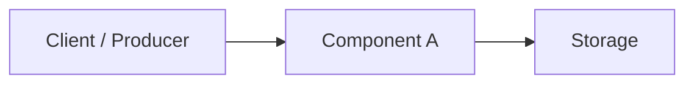

# ADR-NNNN: [Short Imperative Title Summarizing the Decision]

<!--
AUTHORING GUIDELINES (remove HTML comments when drafting a concrete ADR):
1. File naming: Copy this template to `docs/adr/NNNN-short-kebab-title.md` using the next zero-padded 4-digit number (e.g., `0001-use-grpc-for-internal-apis.md`).
2. When to write an ADR: Record architecturally significant decisions at C4 Level 1 (System Context) or Level 2 (Container) - occasionally Level 3 (Component) - that alter trust boundaries or wire contracts, affect quality attributes, or are costly to reverse.
3. Tone: Use concise, factual, value-neutral prose. Keep the total document readable in 3-5 minutes.
4. No strawmen: List only viable alternatives that a qualified engineer could reasonably choose under the same constraints. Keep pros and cons focused on the factors that actually decided the outcome.
5. Immutability: Once `Accepted`, treat an ADR as an immutable historical record. If circumstances change later, write a new ADR and update this file's status to `Superseded by [ADR-XXXX](XXXX-new-decision.md)`.
-->

| Field | Value |
| :--- | :--- |
| **Status** | Proposed \| Accepted \| Deprecated \| Superseded by [ADR-XXXX](XXXX-slug.md) |
| **Date** | YYYY-MM-DD |
| **Deciders** | @github-handle, @github-handle |
| **Related** | Issue #NNN, PR #NNN, [ADR-XXXX](XXXX-slug.md) |

## Context and Problem Statement

<!--
Describe the current system state, technical or operational constraints, and tension (2-5 value-neutral sentences).
Explain why this decision must be made now and end with the core architectural question.
-->

[Describe the architectural context, constraints, and problem statement.]

- **In Scope:** [Components, interfaces, or workflows governed by this decision.]
- **Out of Scope / Non-Goals:** [Adjacent concerns intentionally excluded from this decision.]

## Decision Drivers

<!--
List concrete, testable forces, quality attributes, or constraints shaping the decision
(e.g., security posture, latency/throughput targets, operational complexity, open-source license compatibility, cloud managed-service integration).
-->

- [Driver 1 — e.g., Enforce zero-trust security.]
- [Driver 2 — e.g., Minimize operational overhead.]
- [Driver 3 — e.g., Preserve permissive open-source license compatibility (Apache-2.0).]

## Decision Outcome

<!--
State the chosen option upfront so readers immediately see the decision and primary rationale before diving into the options analysis.
-->

Chosen option: **[Option 1 Name]**, because [concise rationale explaining why this option best satisfies the decision drivers and why its trade-offs are acceptable].

## Considered Options

<!--
Evaluate at least two genuinely viable options (the chosen approach and at least one credible alternative; include "Do nothing / retain baseline" only if realistic).
Describe the architecture of each option in context and include an optional Mermaid `flowchart` diagram per option when topologies, trust zones, or data flows differ (keep each diagram at a single C4 abstraction level).
-->

### 1. [Option 1 Name] (Chosen)

[Describe the architecture, component boundaries, and interaction flow of this option.]

**Pros**

- [Deciding advantage tied to a decision driver]
- [Secondary deciding advantage]

**Cons**

- [Accepted cost, constraint, or limitation]

### 2. [Option 2 Name]

[Describe the architecture, component boundaries, and interaction flow of this alternative. Add an optional `mermaid` diagram if its topology differs.]

**Pros**

- [Strength tied to a decision driver]

**Cons**

- [Drawback or violated driver that led to rejection]

## Consequences

<!--
Describe the resulting system context objectively. Include both benefits and new obligations or constraints.
-->

- **Positive:**
  - [Improvement in reliability, security, developer velocity, performance, or cost.]
- **Negative / Trade-offs:**
  - [New operational responsibility, migration effort, cost baseline, or design constraint.]
- **Risks and Mitigations:**
  - **Risk:** [Specific failure mode, scaling bottleneck, or operational hazard.]
    **Mitigation:** [Concrete architectural guardrail, fallback, quota, or isolation boundary.]

## References

<!--
OPTIONAL: Link external specifications, benchmarks, design docs, or related ADRs.
-->

- [Reference or specification title](https://example.com)
